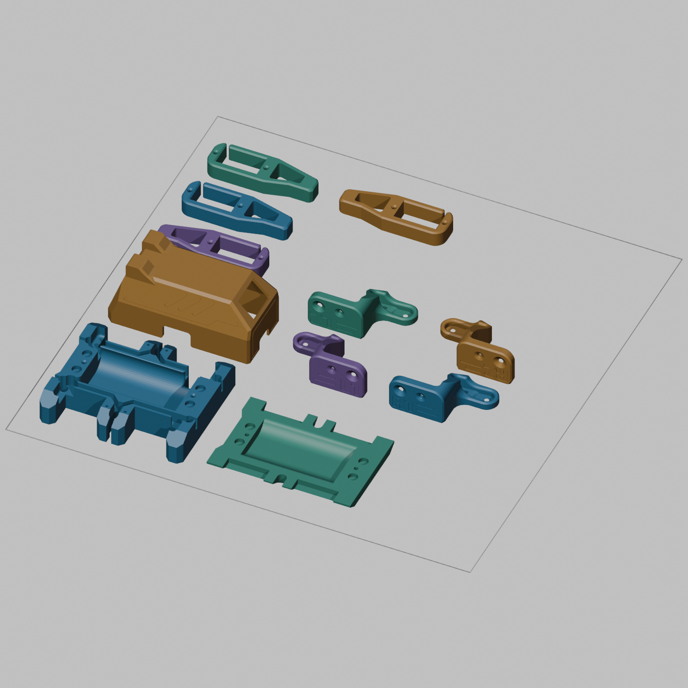

# Sesame – Druckdateien für den Bambu Lab P1S

Vorbereitet am 1. November 2026 mit **Blender 4.3.2** für den vollständigen Grundaufbau: acht Gelenkteile, Innenrahmen, Boden und ein geschlossener Deckel. Jedes Teil ist genau einmal enthalten. Materialplanung: PETG; die offizielle Anleitung bezieht sich auf PLA.

## Welche Datei öffnen?

| Variante | Datei für Bambu Studio | Inhalt |
| --- | --- | --- |
| Alle Teile gemeinsam | [P1S-all-11.3mf](prepared/P1S-all-11.3mf) | Alle elf Teile auf einer 256 × 256-mm-Platte |
| Alternative: Grundteile | [P1S-base-10.3mf](prepared/P1S-base-10.3mf) | Acht Gelenkteile, Innenrahmen und Boden |
| Alternative: Deckel separat | [P1S-cover-1.3mf](prepared/P1S-cover-1.3mf) | Nur der geschlossene Deckel |

**Entweder die gemeinsame Platte oder die beiden getrennten Platten drucken.** Wer alle drei Varianten druckt, erhält einen doppelten Satz.

Die 3MF-Dateien enthalten getrennte, benannte Objekte und Millimeter-Einheiten. Sie sind reine Geometriedateien, keine Bambu-Druckprofile: Drucker, Filament, Schichthöhe und Stützen müssen in Bambu Studio gewählt werden. Keine G-Code-Datei ist enthalten.

Zusätzlich liegen im Ordner `prepared`:

- Eine gleichnamige kombinierte STL je Platte als Ausweichformat.
- Elf einzeln ausgerichtete `*-print.stl`-Dateien für Passproben oder Ersatzteile.
- [Blender-Projekt mit drei Szenen](prepared/Sesame-P1S-print-layout.blend).
- [Prüfbericht](prepared/validation.json) mit Drehungen, Maßen, Auflageflächen und Netzprüfung.

## In Bambu Studio

1. Die gewünschte 3MF-Datei herunterladen und als Modell/Geometrie importieren. P1S mit passender Düse und dein PETG-Materialprofil auswählen.
2. **Maßstab 100 %**, Druckreihenfolge **nach Schicht**. Die Anordnung ist nicht für kollisionsfreie Ausgabe „nach Objekt“ ausgelegt.
3. Die gespeicherte Orientierung beibehalten; nicht pauschal erneut automatisch ausrichten. Bei Rückfragen zur Einheit Millimeter wählen. Kontrollmaße: Innenrahmen etwa **79,23 × 68,08 × 15,70 mm**, R1 etwa **49,52 × 30,48 × 20,32 mm** in Druckausrichtung.
4. Eigener PETG-Startpunkt: 0,20-mm-Schichten, drei Wände und 10–15 % Infill. Das ist kein erprobtes Profil. Temperatur, Kühlung und Geschwindigkeit nach Herstellerprofil des konkreten PETG wählen.
5. Für Gelenke, Rahmen und Boden zunächst ohne Stützen slicen und die Schichtvorschau kontrollieren. Kleine Brücken und Bohrungen können trotzdem Überhangwarnungen auslösen.
6. **Am Deckel gezielte manuelle Stützen einzeichnen**, insbesondere unter frei beginnenden Abschnitten der Hut-/Magnetaufnahmen und überhängenden Öffnungen. Die beigefügten [Referenzbilder](reference/topcover-supports1.png) und das [geslicte Beispiel](reference/sliced-topcover.png) zeigen den ursprünglichen Deckel; die aktuelle v117-Variante im eigenen Slicer zusätzlich prüfen. Keine Stützen pauschal für sämtliche Teile aktivieren.
7. Für den Deckel bei Bedarf einen äußeren Brim verwenden. Anordnung bietet mindestens 10 mm nominellen Plattenrand und 8 mm Abstand zwischen Objekt-Begrenzungsrechtecken. Nach Hinzufügen von Brim/Stützen die tatsächlichen Abstände, P1S-Ausschlussflächen und Slicer-Warnungen erneut prüfen.
8. Bei PETG zuerst ein einzelnes Gelenkteil als Passprobe drucken, bevor die volle Platte startet.

Die Varianten mit separatem Deckel sind praktisch, wenn du seine Stützen oder das Materialprofil erst erproben möchtest. Gemeinsames Drucken spart einzelne Starts und Aufheizvorgänge; eine kürzere Gesamtdruckzeit ist ohne Slicing nicht zugesichert. PETG-Fäden und das Risiko eines Fehlers über mehrere Teile hinweg sprechen beim ersten Versuch für eine kleinere Testplatte.

## Was wurde in Blender optimiert?

- Auflageorientierungen anhand planarer Flächen und geometrischer Überhänge verglichen und visuell mit den offiziellen Hinweisen abgeglichen.
- Hüftgelenke L1/L2/R1/R2 auf die breite Auflage gedreht; Druckhöhe etwa 20,32 mm.
- Lange Gelenkteile L3/L4/R3/R4 flach gelegt; Druckhöhe etwa 9,53 mm.
- Rahmen und Boden flach, offene Funktionsflächen nach oben; Deckel mit Öffnung zur Druckplatte.
- Alle Modelle exakt auf Z = 0 gesetzt und mit Abstand innerhalb der Platte angeordnet.
- Keine Skalierung, Spiegelung, Formänderung oder Vereinfachung des Netzes.
- Im vorbereiteten Deckel **zwei deckungsgleiche, entgegengesetzt gerichtete Dreiecke eines nullvolumigen Netzanhangs entfernt**. Die Originaldatei bleibt unverändert; alle anderen Flächen bleiben erhalten.

Alle vorbereiteten Netze sind nach identischer Positionszusammenfassung geschlossen: jede Kante gehört zu genau zwei Dreiecken. Rücktransformation, Kantenlängen, Objektabstände und Plattengrenzen wurden programmatisch geprüft. Ein Druck oder Test mit Bambu Studio wurde hier nicht durchgeführt. Die Blender-Vorschau zeigt weder Stützen noch Schichten.



## Originale, Quelle und Lizenz

Die elf unveränderten STL-Dateien liegen in [original](original). Verwendet wird `Top-Cover-Enclosed-v117.stl`; die anderen Deckelvarianten und optionalen Hüte sind nicht Teil dieses Drucksatzes.

- Quelle: [dorianborian/sesame-robot](https://github.com/dorianborian/sesame-robot)
- Fixierter Upstream-Commit: [f328ed35f5cbcbdd44a5e16e3ec679d2caa00d92](https://github.com/dorianborian/sesame-robot/tree/f328ed35f5cbcbdd44a5e16e3ec679d2caa00d92/hardware/printing)
- Urheber/Projekt: Dorian Todd und Sesame-Mitwirkende.
- Lizenz der übernommenen Modelle und Referenzen: **Apache-2.0**, siehe [vollständigen Lizenztext](LICENSE.upstream.txt). Bestehende Hinweise im Original bleiben erhalten.
- [Quellenmanifest mit Hashes](source-manifest.json)
- [Unveränderte Druckanleitung als Snapshot](reference/README.upstream.md); ihre relativen Links beziehen sich auf das Upstream-Repository. Die eingebundenen Referenzbilder sind zusätzlich hier gespeichert.

## Neu erzeugen

Aus dem Repository-Stamm mit Blender 4.3.2:

```sh
blender -b --factory-startup --python hardware/printing/tools/prepare_prints.py
```

Das Skript liest die lokalen Original-STLs und erzeugt die vorbereiteten STLs, 3MF-Dateien, Blender-Szenen, Vorschaubilder und den Prüfbericht neu. Ein Grafik-/Renderkontext wird für die Vorschaubilder benötigt. Es lädt nichts aus dem Netz und veröffentlicht keine Dateien.
